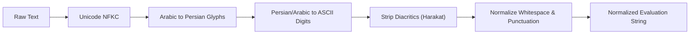

# David Assistant: Quality Metrics & Evaluation Formulations

This document specifies the mathematical formulations, normalization algorithms, tolerance thresholds, and calibration baselines implemented within the Quality Lab (`quality_lab`).

---

## 1. Speech Recognition Evaluation Formulations

### 1.1 Word Error Rate (WER)
Word Error Rate measures the alignment error between the ground truth reference transcription and the hypothesis hypothesis emitted by the STT engine (`faster-whisper`):

$$\text{WER} = \frac{S + D + I}{N}$$

Where:
- $S$: Number of substituted words (Levensthein word-level edit distance).
- $D$: Number of deleted words.
- $I$: Number of inserted words.
- $N$: Total number of words in the reference transcription.

*Evaluation Thresholds:*
- High-quality English Speech: $\text{WER} \le 0.15$
- Iranian Persian Natural Speech: $\text{WER} \le 0.25$
- Noise/Low-Signal Conditions: $\text{WER} \le 0.40$

### 1.2 Character Error Rate (CER)
Character Error Rate is particularly informative for Persian due to orthographic variations (e.g., zero-width non-joiners `\u200C`, suffix attachments):

$$\text{CER} = \frac{S_c + D_c + I_c}{N_c}$$

Where edits are computed at the Unicode character level.
- Iranian Persian Command Target: $\text{CER} \le 0.15$

### 1.3 Downstream Semantic Intent & Argument Match
Transcription similarity alone is insufficient for voice assistants. A transcription that differs by a single digit or tool name will fail in production. Therefore, the Quality Lab evaluates:

1. **Intent Match Accuracy**:
   $$\text{Acc}_{\text{intent}} = \frac{\mathbb{I}(\hat{I} == I_{\text{ref}})}{1}$$
2. **Argument Extraction Accuracy**:
   $$\text{Acc}_{\text{args}} = \frac{\sum_{k \in K_{\text{ref}}} \mathbb{I}(\hat{A}[k] == A_{\text{ref}}[k])}{|K_{\text{ref}}|}$$

---

## 2. Text Normalization Specification

To ensure fair comparisons without penalizing formatting discrepancies, text strings undergo bi-directional normalization via `normalize_evaluation_text()`:

### 2.1 Arabic to Persian Glyph Mapping
| Arabic Source | Persian Normalized Glyph | Unicode Codepoint |
| :--- | :--- | :--- |
| `ي` (Arabic Yeh) | `ی` (Persian Yeh) | `\u06CC` |
| `ى` (Alef Maksura) | `ی` (Persian Yeh) | `\u06CC` |
| `ك` (Arabic Kaf) | `ک` (Persian Kaf) | `\u06A9` |
| `ة` (Teh Marbuta) | `ه` (Heh) | `\u0647` |
| `ۀ` (Heh with Yeh) | `ه` (Heh) | `\u0647` |
| `ؤ` (Waw with Hamza)| `و` (Waw) | `\u0648` |
| `إ` / `أ` / `آ` | `ا` (Bare Alef) | `\u0627` |

### 2.2 Digit Normalization
All Persian (`۰-۹`) and Arabic-Indic (`٠-٩`) numerals are translated to standard ASCII Arabic numerals (`0-9`) to allow mathematical comparison of time intervals and quantities.

### 2.3 Diacritics Stripping
Arabic and Persian short vowels (fatha, damma, kasra, tanwin, sukun, shadda in range `\u064B-\u065F`, `\u0670`) are stripped.

---

## 3. Real-Time Performance & Latency Metrics

### 3.1 Real-Time Factor (RTF)
Measures the computational efficiency of speech synthesis (`Piper ONNX`):

$$\text{RTF} = \frac{\text{Synthesis Processing Time (seconds)}}{\text{Synthesized Audio Duration (seconds)}}$$

- **Target Threshold**: $\text{RTF} \le 0.50$ (audio synthesizes at least twice as fast as playback).
- **Observed Production**: $\text{RTF} \approx 0.04 - 0.08$ on AMD Ryzen CPU (12x-25x faster than real time).

### 3.2 Time-to-First-Token (TTFT)
The latency between dispatching user input and receiving the first emitted completion token from `llama-server.exe`:
- **Target Threshold**: $\text{TTFT} \le 1200\text{ ms}$ (GPU offload enabled) / $\le 3000\text{ ms}$ (CPU-only).

### 3.3 Generation Throughput (Tokens per Second - TPS)
$$\text{TPS} = \frac{\text{Total Generated Tokens}}{\text{Generation Duration (seconds)}}$$
- **Target Threshold**: $\text{TPS} \ge 25.0\text{ tokens/sec}$ (Qwen3-1.7B-Q4_K_M on RTX 3050 Ti).

---

## 4. Wake-Word Activation Metrics

Evaluated via the offline `Vosk` keyword detector (`vosk-model-small-en-us-0.15`):

### 4.1 True Activation Rate (TAR)
$$\text{TAR} = \frac{\text{Successful Activations on Target Keyword}}{\text{Total Target Keyword Presentations}} \times 100\%$$
- **Target Threshold**: $\text{TAR} \ge 95.0\%$

### 4.2 False Activations Per Hour (FAR/hr)
$$\text{FAR/hr} = \frac{\text{False Positive Activations}}{\text{Hours of Continuous Non-Target Speech / Noise}}$$
- **Target Threshold**: $\text{FAR/hr} \le 1.0\text{ / hour}$

---

## 5. Security & Isolation Metrics

| Metric | Target Limit | Enforcement Mechanism |
| :--- | :--- | :--- |
| Unauthorized Tool Invocations | **0** (Zero Tolerance) | Policy allowlist in `PolicyEngine.evaluate()` |
| Arbitrary Shell / PowerShell Leaks | **0** (Zero Tolerance) | Blocked in `PolicyEngine.FORBIDDEN_ACTIONS` |
| Network Outbound Violations | **0** (Zero Tolerance) | Strict loopback enforcement (`127.0.0.1` binding) |
| Plaintext Credentials in Logs | **0** (Zero Tolerance) | Privacy regex filters in `redact_sensitive_text()` |
| Path Traversal Beyond Allowed Roots | **0** (Zero Tolerance) | Strict ancestor resolution against `authorized_roots` |
