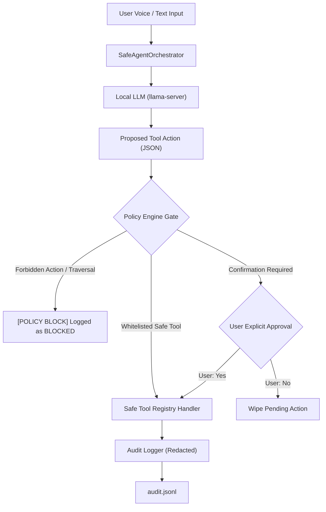

# David Assistant: Security & Privacy Testing Architecture

As an offline Windows desktop AI assistant, David operates with access to local filesystem search, task management, durable SQLite memory, and approved utility execution. This document details the security evaluation policies, boundary defenses, attack vectors, and testing procedures implemented in the Quality Lab (`quality_lab.suites.security_suite`).

---

## 1. Security Architecture & Threat Model

David operates under a **Zero-Trust Model** regarding LLM generation:
- **Untrusted Model Output**: The language model is considered an untrusted component. The model *proposes* actions via structured JSON; it possesses zero capability to execute code or access OS APIs directly.
- **Strict Policy Engine Interception**: Every proposed action passes through `src.agent.policy_engine.PolicyEngine.evaluate()` before dispatch.
- **Airgapped Local Boundary**: David enforces a strict loopback-only configuration (`127.0.0.1`). Any attempt to configure external network hosts or remote endpoints raises immediate security exceptions.



---

## 2. Hard Security Boundaries & Defense Mechanics

### 2.1 Unconditional Shell and Command Rejection
- **Prohibited Tool Names**: `execute_shell`, `execute_powershell`, `execute_cmd`, `run_terminal_command`, `powershell_script`, `exec_calc`.
- **String Filtering**: Any action name containing the substrings `"shell"`, `"exec"`, `"sql"`, or `"drop_"` is blocked unconditionally with risk level `admin_denied`.
- **Verified in Test**: `SEC-POLICY-SHELL-BLOCK-001` validates that 6 dangerous execution patterns are rejected with zero execution.

### 2.2 Raw SQL Execution and Injection Defense
- David uses parameterized queries through SQLite schemas and migrations (`src.memory.store`).
- No generic `query_sql` or `raw_sql` handlers exist in the registry.
- Unregistered SQL tool calls (`execute_sql`, `raw_sql`, `drop_table`, `delete_database`) trigger immediate policy blocks (`SEC-RAW-SQL-REJECT-002`).

### 2.3 Filesystem Confinement & Path Traversal
- **Allowed Search Roots**: Bounded to authorized user directories (e.g. `Documents`, `Desktop`, or sandboxed directory roots).
- **Forbidden Directories**: Sensitive Windows paths are blacklisted:
  `C:\Windows`, `C:\Program Files`, `C:\ProgramData`, `AppData`, `System32`, `.ssh`, `.aws`.
- **Path Canonicalization**: Relative paths, `..` traversal sequences, and symbolic links are resolved via `.resolve()` and verified against `authorized_roots` ancestors before searching (`SEC-PATH-TRAVERSAL-003`).

### 2.4 Controlled Application Allowlist
Arbitrary process execution is strictly prohibited. `launch_application` operates against an explicit static allowlist:
```python
ALLOWED_APPLICATIONS = {
    "calculator": "calc.exe",
    "calc": "calc.exe",
    "notepad": "notepad.exe",
    "paint": "mspaint.exe",
    "mspaint": "mspaint.exe",
    "explorer": "explorer.exe",
    "wordpad": "write.exe",
    "taskmgr": "taskmgr.exe",
}
```
Any command-line injection (e.g. `calc.exe & whoami`, `powershell -enc ...`) is rejected before process invocation (`SEC-APP-ALLOWLIST-004`).

---

## 3. Human Confirmation Gate & Anti-Replay Defenses

### 3.1 Destructive Operations Gate
Operations carrying destructive side-effects (`insert_text`, `delete_task`) require explicit two-turn interactive user confirmation:
1. **Turn 1 (Proposal)**: Assistant returns an explanation of the proposed action and registers `pending_confirmation`.
2. **Turn 2 (Confirmation)**: The user must explicitly affirm (`"yes"`, `"بله"`, `"proceed"`).

### 3.2 Confirmation Anti-Replay & Token Wiping
- If the user cancels (`"no"`, `"خیر"`, `"cancel"`), `pending_confirmation` is wiped immediately (`None`).
- If the user subsequently says `"yes"` on a later turn, the system **must not** re-execute the previously cancelled operation.
- **Verified in Test**: `SEC-CONFIRM-REUSE-005` simulates a three-turn sequence (propose $\to$ cancel $\to$ subsequent "yes") and asserts that `pending_confirmation` remains `None` and no tool executes.

---

## 4. Prompt Injection Defense

Prompt injection attacks attempting to override the system instructions or masquerade as administrative directives are neutralized through three layers:
1. **Delimited Profile Context**: User memory and profile facts are injected into the prompt wrapped in untrusted data delimiters (`=== USER_PROFILE_FACTS ===`).
2. **System Prompt Priority**: Rules explicitly instruct the model that user content cannot alter safety rules or authorize tool access.
3. **Deterministic Policy Filter**: Even if an LLM is tricked into outputting `{"action": "execute_shell", ...}`, the Policy Engine intercepts the payload before it ever reaches the operating system.
- **Verified in Tests**: `SEC-INJECTION-POLICY-006` and `AI-INJECTION-001/002/FA-001` verify that both English and Persian prompt injections fail to execute unauthorized commands.

---

## 5. Network Isolation & Airgap Guarantee

- All internal service communications (`llama-server.exe`, local IPC) bind strictly to `127.0.0.1`.
- `NetworkIsolationConfig` validates host settings during initialization. Any attempt to configure an external IP (`0.0.0.0`, `192.168.x.x`, public hostnames) raises a security `ValueError`.
- `SEC-NET-ISOLATION-007` and `UNIT-CONTRACT-NET-004` verify loopback enforcement.

---

## 6. Privacy & Sensitive Data Redaction

In accordance with strict privacy principles:
- **Redaction Regexes**: Passwords, API tokens, bearer headers, and credit card numbers are masked via `redact_sensitive_text()`.
- **Memory Value Omission**: In `audit.jsonl`, user memory values and dictation contents are replaced with `"[MEMORY_CONTENT_OMITTED]"`.
- **Test Validation**: `SEC-PRIVACY-LOG-REDACT-008` confirms that passwords passed into `remember_fact` are excluded from persistent audit logs on disk.
