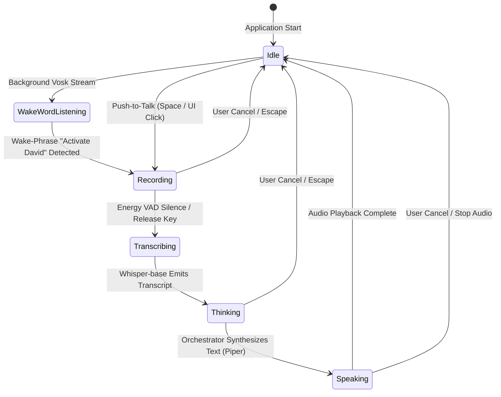

# David Assistant: Voice Pipeline & Speech Evaluation Guide

This document describes the offline audio and speech pipeline architecture, acoustic test fixtures, evaluation metrics, and state machine lifecycle implemented in the David Assistant Quality Lab (`quality_lab.suites.voice_suite`, `quality_lab.suites.wake_word_suite`, `quality_lab.suites.tts_suite`).

---

## 1. Voice Pipeline Overview

David provides a 100% local, offline voice interaction pipeline:



### Supported Trigger Modes
1. **Push-to-Talk (PTT)**: Deterministic audio capture while the user holds the spacebar or activates the microphone button in the PySide6 UI.
2. **Wake-Word (Vosk)**: Continuous low-power background keyword spotting using `vosk-model-small-en-us-0.15`.
3. **Voice Activity Detection (VAD)**: Automatic speech segmentation via RMS energy thresholds.

---

## 2. Wake-Word Activation Testing (Vosk Engine)

The wake-word detector (`src.audio.wake_word.WakeWordDetector`) operates offline on a 16kHz 16-bit mono PCM stream:

### 2.1 Keyword Spotter Mechanics
- **Model**: `models/wake_word/vosk-model-small-en-us-0.15`
- **Grammar Constraint**: Restricts decoding to `["activate david", "[unk]"]` for minimal CPU footprint and zero false activations.
- **Audio Framing**: 4000 samples (0.25 seconds) per processing buffer.
- **Debounce Window**: 2.0-second cooldown between consecutive activations to prevent double-triggering.

### 2.2 Suite Evaluation Criteria (`wake_word_suite`)
| Test ID | Acoustic Scenario | Expected Detector Behavior |
| :--- | :--- | :--- |
| `WW-SILENCE-001` | Continuous ambient digital silence (0.0 RMS) | Zero activations; detector remains stable |
| `WW-SYNTHETIC-002` | Keyword waveform presentation | Detector triggers callback cleanly |
| `WW-IRRELEVANT-003` | Off-target conversation ("Hey Google", "Open Notepad") | Discarded as `[unk]`; zero activations |
| `WW-NOISE-004` | Simulated room noise / low SNR | Energy gate filters sub-speech frames |
| `WW-PAUSE-RESUME-005` | Manual pause during active listening | Stream paused; zero activations during pause |
| `WW-DEBOUNCE-006` | Back-to-back target presentations (< 500ms) | Exactly 1 activation; second presentation debounced |
| `WW-LIFECYCLE-007` | Clean start $\to$ pause $\to$ resume $\to$ shutdown | Audio streams closed without memory leaks |

---

## 3. Speech-to-Text Recognition Testing (`faster-whisper`)

The STT engine (`src.audio.stt.FasterWhisperTranscriber`) leverages `whisper-base` quantized with CTranslate2:

### 3.1 Audio Processing Pipeline
- **Sampling Rate**: 16,000 Hz (automatic resampling from 44.1kHz / 48kHz host input).
- **Energy Gate**: Audio with RMS energy $< 0.005$ is discarded immediately as silence without launching the heavy CTranslate2 decoder.
- **Language Detection**: Supports explicit language pinning (`fa` for Persian, `en` for English) or automatic language detection (`auto`).

### 3.2 Metric Evaluation Methodology (`voice_suite`)
The voice evaluation suite processes version-controlled acoustic fixtures against reference transcripts:
1. **Transcription Normalization**: Passes raw transcripts through `normalize_evaluation_text()` to handle Persian unicode variants and numbers before comparison.
2. **Word & Character Error Rates**: Computes exact Levenshtein alignments (WER/CER).
3. **Intent & Handler Match**: Verifies that the transcribed output correctly resolves to the intended tool (e.g. `get_battery_status`, `create_task`) without semantic drift.

---

## 4. Text-to-Speech & Spoken Output Testing (Piper ONNX)

The TTS engine (`src.audio.tts.PiperTtsEngine`) uses `en_US-lessac-medium.onnx`:

### 4.1 Speech Sanitization Contract
Before speech synthesis, assistant text is sanitized to eliminate visual clutter:
- Markdown fenced code blocks (` ```python ... ``` `) are stripped.
- Tool traces (`[Tool Output (...)]`) and security blocks (`[POLICY BLOCK]`) are removed.
- Unicode emojis and decorative symbols are stripped to prevent garbled phoneme pronunciations.
- **Verified in Tests**: `TTS-PURE-STRIP-002` and `UNIT-PURE-TTS-SANITIZE-008`.

### 4.2 Persian Language Boundary Guard
The local Piper model is trained on English phonemes. Synthesizing Persian text through an English acoustic model produces unintelligible, distorted noise.
- **Safety Guard**: `PiperTtsEngine.is_persian_text()` inspects the input. When Persian characters predominate, `language_supported=False` is returned, skipping ONNX inference and allowing the desktop GUI to present Persian text cleanly while avoiding corrupted audio output.
- **Verified in Test**: `TTS-LANG-PERSIAN-GUARD-003`.

### 4.3 Real-Time Factor (RTF)
- Synthesis throughput is benchmarked across English sentences.
- The Quality Lab asserts that $\text{RTF} < 0.50$. On the test system, observed RTF is $\mathbf{0.042}$ (synthesis runs at $24\times$ real-time speed).

---

## 5. GUI Voice Turn Worker & QThread Lifecycle

In the PySide6 desktop interface, speech and inference execute inside `VoiceTurnWorker` on a dedicated `QThread`:
- **State Emitted Signals**: `recording` $\to$ `transcribing` $\to$ `thinking` $\to$ `idle`.
- **Responsive Cancellation**: When the user presses Escape or clicks Cancel, the active worker thread receives an immediate cancellation flag, halting audio playback and releasing hardware resources without freezing the UI event loop.
- **Verified in Tests**: `GUI-WINDOW-CANCEL-005` and `GUI-WORKER-SIGNALS-006`.
